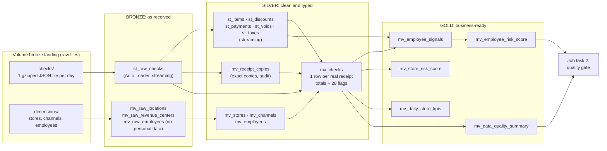
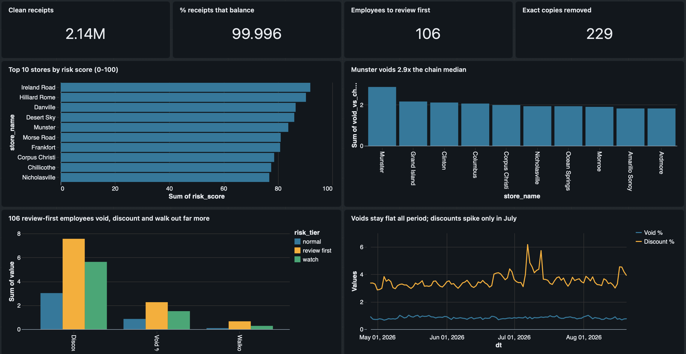

# Applebee's Risk Signals: Databricks Pipeline

Tec de Monterrey × Sun Holdings × Databricks Data Challenge · **Applebee's AI-Powered Fraud Detection** track · Phase 2 (pipeline)

A Lakeflow Declarative Pipeline, orchestrated by a Databricks job and deployed as a Databricks Asset Bundle, that turns 115 days of raw point-of-sale receipts from 127 RMH Applebee's restaurants into tables that answer one question: **where can money leak at the register (voids, discounts, comps, walkouts, tips, refunds), and who and where should a manager review first?**

The data has **no fraud labels**, so everything the pipeline produces is a **risk signal**, never proof of fraud.

---

## At a glance: the Phase 2 deliverables

| Deliverable | Where |
|---|---|
| GitHub repository and run instructions | This README: [repository layout](#repository-layout), [how to run it](#how-to-run-it) |
| Pipeline job: trigger, dependencies, failures and reruns | [`resources/jobs/daily_orchestration_job.yml`](resources/jobs/daily_orchestration_job.yml) · [The job](#the-job) |
| Pipeline overview: source to final tables | [`resources/pipelines/lakeflow_pipeline.yml`](resources/pipelines/lakeflow_pipeline.yml) · [Architecture](#architecture) |
| Transformations and the value of each table | [`src/transformations/`](src/transformations/) · [Tables](#tables-and-what-they-are-for) |
| Data-quality checks | Expectations in every layer + [`src/validation/quality_gate.py`](src/validation/quality_gate.py) · [Data-quality checks](#data-quality-checks) |
| Streaming, materialized views, liquid clustering, expectations | [Databricks features](#databricks-features-where-and-why) |
| Analysis and business value | Gold tables + AI/BI dashboard · [Analysis](#analysis-who-and-where-to-look-first) |

Full design notes for every stage, table and check: [`docs/PIPELINE.md`](docs/PIPELINE.md). Screenshots of every run: [`docs/img/`](docs/img/).

---

## Results

- **All 115 days processed** (Apr 28 – Aug 20, 2026; 2,142,846 raw receipts): 229 exact copies removed, **2,142,617 clean receipts**, 99.996% of receipts financially balanced. Quality gate **12 / 12**.
- **Exact parity with Phase 1.** Phase 1 cleaned the data with DuckDB on a laptop; this pipeline re-implements the rules in Spark. Both give the same clean receipts, copies, employees compared (2,516) and employees flagged (106) ([PIPELINE.md §9](docs/PIPELINE.md#9-proof-that-the-port-is-correct-parity-with-phase-1)).
- **Incremental loading.** Adding a second week of files read only the new files: 136K rows, exactly the 136,487 new receipts ([screenshot](docs/img/06_incremental_week2_only_136k.png)).
- **The safety net works.** On the full load, an automatic pipeline retry left the main receipt table wrong; the quality gate blocked the job, and only the affected tables were rebuilt ([details](#3-it-caught-a-real-error)).
- **Business result:** 106 of 2,516 employees are flagged *review first*, and Munster voids 2.87× the chain median ([analysis](#analysis-who-and-where-to-look-first)).

---

## Architecture



- **Source:** one JSON file per business day (each receipt nests its item lines, discounts, payments, taxes and voids) plus lookup files for stores, sales channels and employees. Files are gzipped (~16× smaller) and land in a Unity Catalog volume.
- **Bronze:** data exactly as received, with an explicit schema, ingestion metadata and a content fingerprint per receipt.
- **Silver:** nested arrays flattened into line tables, types and labels cleaned, exact copies removed, one clean row per receipt with money totals and 20 flags.
- **Gold:** risk signals and explainable risk scores per employee and per store, daily KPIs and a per-day data-quality report.
- Naming follows the template: `st_` = streaming table, `mv_` = materialized view; each layer is its own schema (`workspace.bronze`, `.silver`, `.gold`). Pipeline graph of a real run: [screenshot](docs/img/05_pipeline_graph.png).

---

## The job

[`resources/jobs/daily_orchestration_job.yml`](resources/jobs/daily_orchestration_job.yml)

```
refresh_pipeline  ──►  quality_gate
```

| | Design |
|---|---|
| **Tasks** | `refresh_pipeline`: triggered update of the whole pipeline (bronze → silver → gold; Databricks orders and parallelizes the tables from the code). `quality_gate`: notebook with 12 table-level checks, runs only if the pipeline succeeds. |
| **Trigger** | Daily at 06:00 America/Monterrey, after the previous business day's file lands. Deployed **paused** to save Free Edition compute; run on demand with `databricks bundle run`. A file-arrival trigger on the volume is the alternative we considered. |
| **Failures** | `refresh_pipeline` retries once after 5 min (transient errors); `quality_gate` never retries (a failed check needs a person). Timeouts: 1 h per task, 2 h per job. Failure e-mail to the owner. Max 1 concurrent run, so two runs never write the same tables. |
| **Reruns** | Idempotent: Auto Loader checkpoints mean a file is never loaded twice, and materialized views recompute from their inputs. *Repair run* re-runs only the failed task. A rule change is applied with a full refresh, rebuilding every table from the files in the volume. |

Job run with both tasks green: [screenshot](docs/img/17_full_run_job_green.png).

---

## Data-quality checks

Every run is checked twice: **expectations** test each row while the tables are built, and a **quality gate** tests whole tables after the pipeline finishes. Screenshots are from the full 115-day run.

### 1. While building: expectations on every row

Each rule has an action. **FAIL** stops the pipeline, **DROP** removes the row and counts it, **ALLOW** (warn) keeps the row and counts it. Most rules only warn, on purpose: in fraud work unusual receipts are the evidence, so they are flagged, not deleted.

| Table | Rules | Code | Result (115 days) |
|---|---|---|---|
| `bronze.st_raw_checks` (raw receipts) | FAIL: file can't be dated · DROP: receipt has no ID or store · ALLOW: business date ≠ file date, data outside the schema | [`st_raw_checks.py`](src/transformations/bronze/st_raw_checks.py) | 0 failures, 0 dropped ([screenshot](docs/img/24_expectations_bronze_full_run.png)) |
| `silver.mv_checks` (clean receipts) | 12 ALLOW rules: money identity balances, has items, has payment, no negative prices, closed within 6 h, normal size, plausible check ID, priced lines have quantity, times parsed, closes after it opens, known store, known channel | [`mv_checks.sql`](src/transformations/silver/mv_checks.sql) | 2,142,617 written, **0 dropped**; e.g. 17,981 priced lines with quantity 0, 11,301 with no items, 78 unbalanced, all flagged and kept ([screenshot](docs/img/25_expectations_mv_checks_full_run.png)) |
| Silver line tables, gold | non-negative prices, parsed times, rates between 0 and 1 | [`st_receipt_lines.py`](src/transformations/silver/st_receipt_lines.py), [`mv_employee_signals.py`](src/transformations/gold/mv_employee_signals.py) | warn only |

### 2. After building: the quality gate (job task 2)

[`src/validation/quality_gate.py`](src/validation/quality_gate.py) runs 12 checks on the finished tables. If any fails, the notebook raises an error, **the job fails and e-mails the owner**. Every result is appended to `gold.quality_gate_results`.

| # | Dimension | Check | Rule |
|---|---|---|---|
| 1 | Uniqueness | No duplicate receipt key (dt + store + check) in `silver.mv_checks` | = 0 |
| 2 | Uniqueness | No exact-copy receipt left in `silver.mv_checks` | = 0 |
| 3 | Consistency | Bronze receipts = silver receipts + copies removed, every day | = 0 differences |
| 4 | Completeness | Every day in bronze reached silver | = 0 missing |
| 5 | Completeness | No receipt without day, store or number | = 0 |
| 6 | Completeness | Share of receipts from a known store | ≥ 99.9% |
| 7 | Accuracy | Share of receipts whose money identity balances | ≥ 99.9% (got 99.996%) |
| 8 | Validity | Share of receipts with any data-quality flag | ≤ 5% (got 1.97%) |
| 9 | Validity | Receipts with off-schema (rescued) data | = 0 |
| 10 | Validity | Risk scores inside 0–100 | = 0 outside |
| 11 | Validity | Eligible employees available for the score | ≥ 100 (got 2,516) |
| 12 | Privacy | No name, birth-date or payroll columns in bronze, silver or gold | = 0 |

Result on the full run: **12 of 12 passed** ([screenshot](docs/img/23_quality_gate_12_of_12_full_run.png)).

Money identity used by check 7: `amount paid + gratuity = item sales − check discounts + tax`.

### 3. It caught a real error

On the first full 115-day run, Databricks retried the pipeline automatically and the retry left `silver.mv_checks` wrong (exact copies still in, no store names). **The gate failed checks 2 and 6 and blocked the job** ([screenshot](docs/img/12_full_run_gate_10_of_12.png)). We rebuilt only the affected tables (no re-ingestion), re-ran the gate with *Repair run*, and it passed ([counts after the fix](docs/img/16_full_run_counts_fixed.png), [job green](docs/img/17_full_run_job_green.png)).

Per-day quality report (raw vs clean receipts, copies removed, % balanced, % flagged): `gold.mv_data_quality_summary` ([screenshot](docs/img/08_data_quality_summary_14_days.png)). Every check explained by dimension: [PIPELINE.md §6](docs/PIPELINE.md#6-data-quality-every-check-by-dimension).

---

## Databricks features: where and why

| Feature | Where | Why |
|---|---|---|
| **Streaming tables** (Auto Loader) | `bronze.st_raw_checks`, the 5 silver line tables | Files arrive daily and are append-only; each run processes only the new files (checkpointed). Triggered, not continuous: one file a day doesn't justify a 24/7 stream. |
| **Materialized views** | Lookups, `silver.mv_receipt_copies`, `silver.mv_checks`, all of gold | Finding copies, totaling receipts and ranking employees need whole groups of rows, which append-only streaming can't recompute when inputs change. Databricks refreshes them incrementally when it can ([screenshot](docs/img/06_incremental_week2_only_136k.png) shows *Incremental* vs *Full recompute*). |
| **Liquid clustering** | `(dt, location_id)` on receipts, line tables and daily KPIs; `employee_id` on employee signals; `(risk_tier, main_store_id)` on the employee score | Matches how the tables are filtered (a day, a store, an employee). Replaces fixed partitioning and can be changed without rewriting. At this data size the gain is small; it matters as the data grows. |
| **Expectations** | All three layers, all three actions | See [data-quality checks](#data-quality-checks). |
| **Unity Catalog** | Schemas per layer, managed volume for raw files, table comments and properties (`quality`, `contains_pii`) | One governed place for files and tables. |
| **Asset Bundles** | `databricks.yml`, `resources/` | Pipeline, job, schemas and volume deploy from git with one command. The same code was deployed to two workspaces (`-t dev`, `-t full`). |
| **AI/BI dashboard** | On the gold tables | Analysis for managers, up to date after every run. |
| Not used | Continuous streaming; a trained ML model | One file a day; no fraud labels to train or validate a model, so an explainable score comes first. |

---

## Tables and what they are for

| Layer | Table | Grain | Used for |
|---|---|---|---|
| bronze | `st_raw_checks` | 1 receipt, nested, as received | Single source of truth; replay; content fingerprint for copies |
| bronze | `mv_raw_locations`, `mv_raw_revenue_centers`, `mv_raw_employees` | lookup rows | Store names, channels, anonymous HR attributes |
| silver | `st_items`, `st_discounts`, `st_payments`, `st_voids`, `st_taxes` | 1 line | Line-level analysis (who voided what, which discount, which tip) |
| silver | `mv_receipt_copies` | 1 removed copy | Audit: what was removed and which receipt was kept |
| silver | `mv_checks` | 1 real receipt | The clean fact table: money totals, 8 data-quality, 8 risk-behavior and 4 context flags |
| silver | `mv_stores`, `mv_channels`, `mv_employees` | lookup | Joins and filters |
| gold | `mv_employee_signals` | 1 employee | 6 risk signals as rates + eligibility |
| gold | `mv_employee_risk_score` | 1 eligible employee | 0–100 score, top-10% signal count, tier: who to review first |
| gold | `mv_store_risk_score` | 1 restaurant | Same signals vs the chain median: where to look first |
| gold | `mv_daily_store_kpis` | 1 restaurant × day | Dashboard trends |
| gold | `mv_data_quality_summary` | 1 day | Data-quality evidence: raw vs clean, copies, balance, flags |
| gold | `quality_gate_results` | 1 check × run | History of every quality-gate run (written by the job) |

Every transformation and why it exists: [PIPELINE.md §3–5](docs/PIPELINE.md#3-bronze-getting-the-raw-data-in).

---

## Analysis: who and where to look first



- **Signals are rates:** void $ ÷ gross sales, discount $ ÷ gross sales, walkouts per receipt, fully comped receipts per receipt, card tips larger than the bill per card payment. Busy employees don't look worse for being busy. Employees are compared if they have $5,000+ in sales and 50+ card payments (2,516 people).
- **Risk score** (0–100): the average of an employee's percentiles on the 5 signals. **Tier:** *review first* = top 10% on 3+ signals, *watch* = 2, *normal* = 0–1.
- **106 employees are *review first*:** they void 2.6× as much of their sales as everyone else (2.26% vs 0.86%), give 2.5× the discounts (7.56% vs 3.02%) and have 7.6× the walkout rate (0.66% vs 0.09% of receipts), while ringing only 2.9% of sales. If the signals were unrelated, about 22 employees would land there by chance; we see 106, **4.9× chance**.
- **Two kinds of risky store:** high on several signals at once (Ireland Road, Hilliard Rome, Danville lead the store score), or extreme on one: **Munster voids 2.29% of sales, 2.87× the chain median**; Morse Road has the highest walkout rate in the top 10.
- **Risk is about who and where, not when:** the chain's void rate stays at 0.7–1.0% of sales every day of the period.

Employee IDs are anonymous POS IDs; the pipeline contains no names, and individual employees are not shown in any report.

---

## Repository layout

Follows the organizers' template (orchestration in `resources/`, table logic in `src/transformations/`), plus a `bronze/` layer for raw ingestion and `src/validation/` for the quality gate.

```
databricks-challenge/
├── databricks.yml                      bundle: name, catalog variable, targets dev and full
├── resources/
│   ├── jobs/
│   │   └── daily_orchestration_job.yml     job: 2 tasks, schedule, retries, timeouts, failure e-mail
│   └── pipelines/
│       └── lakeflow_pipeline.yml           pipeline + bronze/silver/gold schemas + landing volume
├── src/
│   ├── transformations/                every file here is part of the pipeline
│   │   ├── bronze/
│   │   │   ├── st_raw_checks.py            raw receipts: Auto Loader, explicit schema, FAIL/DROP/WARN
│   │   │   └── mv_raw_dimensions.py        stores, channels, employees (personal data never parsed)
│   │   ├── silver/
│   │   │   ├── st_receipt_lines.py         items, discounts, payments, voids, taxes (flattened)
│   │   │   ├── mv_receipt_copies.sql       exact-copy receipts removed (audit list)
│   │   │   ├── mv_dimensions.sql           clean stores, channels, employees
│   │   │   └── mv_checks.sql               clean receipt table: totals, 20 flags, 12 expectations
│   │   └── gold/
│   │       ├── mv_employee_signals.py      6 risk signals per employee, as rates
│   │       ├── mv_employee_risk_score.sql  0–100 explainable score + tier per employee
│   │       ├── mv_store_risk_score.sql     same per restaurant, vs the chain median
│   │       ├── mv_daily_store_kpis.sql     daily KPIs per restaurant
│   │       └── mv_data_quality_summary.sql per day: raw vs clean, copies, balance rate, every flag
│   └── validation/
│       ├── quality_gate.py                 job task 2: 12 table-level checks, fails the job on error
│       └── local_dry_run.py                same logic locally with PySpark (parity test vs Phase 1)
├── docs/
│   ├── PIPELINE.md                     design notes: every stage, table, check and decision
│   ├── PHASE2_BRIEF.md                 the organizers' brief, rubric and template
│   └── img/                            screenshots of the Databricks runs
└── phase1_eda/                         Phase 1: local exploratory analysis with DuckDB (code, charts, findings)
```

---

## How to run it

Everything deploys from this repo with the Databricks CLI (Asset Bundles). We used **Databricks Free Edition**, catalog `workspace`.

### 1. Set up and deploy

```bash
brew tap databricks/tap && brew install databricks        # Databricks CLI (macOS)
databricks auth login --host https://<your-workspace>.cloud.databricks.com
# put the same URL in databricks.yml → targets.dev.workspace.host
databricks bundle validate
databricks bundle deploy        # creates schemas, landing volume, pipeline and job
```

The bundle owns the `bronze` / `silver` / `gold` schemas and the volume; don't create them by hand.

### 2. Upload the raw files

The raw data (11 GB) is not in git. Gzip each day file and keep the name `checks_YYYY-MM-DD.json.gz`: the pipeline reads the business day from it.

```bash
mkdir -p upload/checks upload/dimensions
for f in "Applebees Challenge"/facts/checks/brand=rmh/dt=*/checks.json; do
  d=$(basename "$(dirname "$f")" | sed 's/dt=//'); gzip -c "$f" > upload/checks/checks_$d.json.gz
done
gzip -c "Applebees Challenge/dimensions/locations/locations.json"            > upload/dimensions/locations.json.gz
gzip -c "Applebees Challenge/dimensions/revenue_centers/revenueCenters.json" > upload/dimensions/revenue_centers.json.gz
gzip -c "Applebees Challenge/dimensions/employees/employees.json"            > upload/dimensions/employees.json.gz

V=dbfs:/Volumes/workspace/bronze/landing
databricks fs mkdir $V/checks && databricks fs mkdir $V/dimensions
for f in upload/dimensions/*.json.gz; do databricks fs cp "$f" "$V/dimensions/$(basename $f)"; done
for f in upload/checks/*.json.gz;     do databricks fs cp "$f" "$V/checks/$(basename $f)"; done
```

### 3. Run

```bash
databricks bundle run daily_orchestration_job
```

In the workspace: **Jobs & Pipelines** → `applebees_daily_orchestration` (task graph, quality-gate output) and `applebees_risk_pipeline` (table graph, row counts, expectation results).

**Incremental load:** upload more day files to `checks/` and run the job again; only the new files are read. **Second workspace:** `databricks bundle deploy -t full` / `databricks bundle run -t full daily_orchestration_job` (add `-p <profile>` to the `fs` commands).

### 4. Local dry run (optional, no Databricks)

```bash
pip install pyspark==4.0.1            # needs Java 17+
python src/validation/local_dry_run.py . <folder with checks/ and dimensions/>
```

Runs the same transformation code in batch on local files and prints the parity numbers and every expectation's violation count.

---

## Design principles

1. **Flag, don't delete.** Unusual receipts are the signal in fraud work. Problems become flags and warn-level expectations; only exact copies are removed, and every one is listed in `mv_receipt_copies`.
2. **Rates, not totals** when comparing employees or stores.
3. **Risk signal, not fraud.** No labels exist; a high score means "review first".
4. **Privacy by design.** Names, birth dates and payroll IDs in the HR file are never parsed, so they exist in no table; the quality gate checks it on every run.
5. **Everything as code.** Pipeline, job, schemas and volume are defined in this repo and deploy with one command.
6. **Verify against an independent implementation.** The Spark pipeline reproduces the Phase 1 DuckDB numbers exactly.
