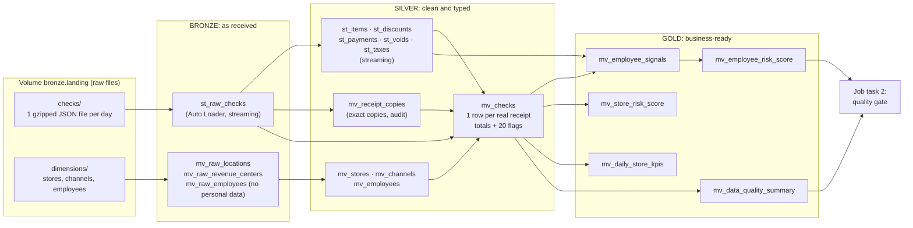

# Applebee's Risk Signals: Databricks Pipeline

Tec de Monterrey × Sun Holdings × Databricks Data Challenge · **Applebee's AI-Powered Fraud Detection** track · Phase 2 (pipeline)

**What it does:** takes the raw point-of-sale (POS) receipts of 127 RMH Applebee's restaurants and turns them into tables that answer one business question: **where can money leak at the register (voids, discounts, comps, walkouts, tips, refunds), and who and where should a manager look at first?**

The data has **no fraud labels**, so everything the pipeline produces is a **risk signal** or an **anomaly**, never proof of fraud.

> **New here?**
> - **Presenting:** read [`docs/PRESENTER_GUIDE.md`](docs/PRESENTER_GUIDE.md) (15 min: story, glossary, slide-by-slide script, Q&A).
> - **Building the deck:** [`docs/PHASE2_PLAN.md`](docs/PHASE2_PLAN.md) → "Presentation outline" and "Numbers for the slides" (which number and which screenshot from [`docs/img/`](docs/img/) goes on each slide).
> - **Data-quality checks:** see [Data-quality checks](#data-quality-checks) below (code links + screenshots).
> - **Full detail / hard questions:** [`docs/PIPELINE.md`](docs/PIPELINE.md). Phase 1 is archived in [`phase1_eda/`](phase1_eda/README.md).

---

## Results (Oct 28, 2026)

- **Full run, all 115 days (2,142,846 receipts):** same numbers as the independent Phase 1 implementation: 229 exact copies removed, 2,142,617 clean receipts, 99.996% balance, 2,516 employees compared. Quality gate 12/12.
- **Incremental loading proven:** adding a second week read only the new files (136K rows = exactly the new week).
- **Safety net proven:** the quality gate blocked the job twice (a false alarm in our own privacy check, and a real error after Databricks' automatic recovery on the full load); both fixed by re-running only what failed.
- **Analysis:** 106 of 2,516 employees are flagged *review first* (2.6× the void rate, 2.5× the discounts, 7.6× the walkouts of the rest; 4.9× what chance gives). Munster voids 2.29% of sales, 2.87× the chain median.
- **Dashboard:** an AI/BI dashboard on the gold tables ([screenshot](docs/img/22_dashboard_overview.png)).

Evidence: [`docs/img/`](docs/img/) (22 screenshots) and [`docs/PIPELINE.md` §9–10](docs/PIPELINE.md).

## Data-quality checks

Every run is checked twice: **expectations** test each row while the tables are built, and a **quality gate** tests whole tables after the pipeline finishes. Screenshots below are from the full 115-day run (2,142,846 receipts).

### 1. While building: expectations on every row

Each rule has an action. **FAIL** stops the pipeline, **DROP** removes the row and counts it, **ALLOW** (warn) keeps the row and counts it. Most rules only warn on purpose: in fraud work the odd receipts are the evidence, so they are flagged, not deleted.

| Table | Rules | Code | Result (115 days) |
|---|---|---|---|
| `bronze.st_raw_checks` (raw receipts) | FAIL: file can't be dated · DROP: receipt has no ID or store · ALLOW: business date ≠ file date, data outside the schema | [`st_raw_checks.py`](src/transformations/bronze/st_raw_checks.py) | 0 failures, 0 dropped ([screenshot](docs/img/24_expectations_bronze_full_run.png)) |
| `silver.mv_checks` (clean receipts) | 12 ALLOW rules: money identity balances, has items, has payment, no negative prices, closed within 6 h, normal size, plausible check ID, priced lines have quantity, times parsed, closes after it opens, known store, known channel | [`mv_checks.sql`](src/transformations/silver/mv_checks.sql) | 2,142,617 written, **0 dropped**; e.g. 17,981 priced lines with qty 0, 11,301 no items, 78 unbalanced, all flagged and kept ([screenshot](docs/img/25_expectations_mv_checks_full_run.png)) |
| Silver line tables, gold | non-negative prices, parsed times, rates between 0 and 1 | [`st_receipt_lines.py`](src/transformations/silver/st_receipt_lines.py), [`mv_employee_signals.py`](src/transformations/gold/mv_employee_signals.py) | warn only |

### 2. After building: the quality gate (job task 2)

[`src/validation/quality_gate.py`](src/validation/quality_gate.py) runs 12 checks on the finished tables. If any fails, the notebook raises an error, **the job fails and e-mails the owner**. Every result is stored in `gold.quality_gate_results`.

| # | Dimension | Check | Rule |
|---|---|---|---|
| 1 | Uniqueness | No duplicate receipt key (dt + store + check) in `silver.mv_checks` | = 0 |
| 2 | Uniqueness | No exact-copy receipt left in `silver.mv_checks` | = 0 |
| 3 | Consistency | Bronze receipts = silver receipts + copies removed, every day | = 0 differences |
| 4 | Completeness | Every day in bronze reached silver | = 0 missing |
| 5 | Completeness | No receipt without day, store or number | = 0 |
| 6 | Completeness | Share of receipts from a known store | ≥ 99.9% |
| 7 | Accuracy | Share of receipts whose money identity balances | ≥ 99.9% (got 99.996%) |
| 8 | Validity | Share of receipts with any data-quality flag | ≤ 5% (got 1.97%) |
| 9 | Validity | Receipts with off-schema (rescued) data | = 0 |
| 10 | Validity | Risk scores inside 0–100 | = 0 outside |
| 11 | Validity | Eligible employees available for the score | ≥ 100 (got 2,516) |
| 12 | Privacy | No name, birth-date or payroll columns in bronze, silver or gold | = 0 |

Result on the full run: **12 of 12 passed** ([screenshot](docs/img/23_quality_gate_12_of_12_full_run.png)).

### 3. It caught a real error

On the first full 115-day run, Databricks retried the pipeline automatically and the retry left `silver.mv_checks` wrong (exact copies still in, no store names). **The gate failed checks 2 and 6 and blocked the job** ([screenshot](docs/img/12_full_run_gate_10_of_12.png)). We rebuilt only the affected tables (no re-ingestion), re-ran the gate with *Repair run*, and it passed ([counts after the fix](docs/img/16_full_run_counts_fixed.png), [job green](docs/img/17_full_run_job_green.png)).

Per-day quality report (raw vs clean receipts, copies removed, % balanced, % flagged): table `gold.mv_data_quality_summary` ([screenshot, 14-day demo](docs/img/08_data_quality_summary_14_days.png)). Full explanation of every check: [`docs/PIPELINE.md`](docs/PIPELINE.md) §6.

## Architecture



`st_` = **streaming table** (processes only new data on each run) · `mv_` = **materialized view** (a stored query result Databricks keeps up to date).

One **Databricks job** runs it all: `refresh_pipeline` (the whole flow above) → `quality_gate` (checks the result and fails the job if something is wrong).

---

## Repository layout

Follows the organizers' template: orchestration in `resources/`, table logic in `src/transformations/`.

```
databricks-challenge/
├── databricks.yml                      bundle config: project name, workspace, catalog variable
├── resources/
│   ├── jobs/
│   │   └── daily_orchestration_job.yml     the job: 2 tasks, schedule, retries, failure e-mail
│   └── pipelines/
│       └── lakeflow_pipeline.yml           the pipeline + the bronze/silver/gold schemas and landing volume
├── src/
│   ├── transformations/                every file here is part of the pipeline
│   │   ├── bronze/
│   │   │   ├── st_raw_checks.py            raw receipts, incremental (Auto Loader), schema contract, 3 expectation levels
│   │   │   └── mv_raw_dimensions.py        stores, channels, employees (personal data never parsed)
│   │   ├── silver/
│   │   │   ├── st_receipt_lines.py         items, discounts, payments, voids, taxes (flattened from the nested JSON)
│   │   │   ├── mv_receipt_copies.sql       exact-copy receipts removed (audit list)
│   │   │   ├── mv_dimensions.sql           clean stores, channels, employees
│   │   │   └── mv_checks.sql               THE clean receipt table: totals, 8 quality + 8 risk + 4 context flags
│   │   └── gold/
│   │       ├── mv_employee_signals.py      6 risk signals per employee, as rates
│   │       ├── mv_employee_risk_score.sql  0-100 explainable score + tier per employee
│   │       ├── mv_store_risk_score.sql     same per restaurant, vs the chain median
│   │       ├── mv_daily_store_kpis.sql     daily KPIs per restaurant (dashboard)
│   │       └── mv_data_quality_summary.sql per day: raw vs clean, copies, balance rate, every flag
│   └── validation/
│       ├── quality_gate.py                 job task 2: table-level checks, fails the job on error
│       └── local_dry_run.py                runs the same logic locally with PySpark (parity test vs Phase 1)
├── docs/
│   ├── PRESENTER_GUIDE.md              15-minute read: story, glossary, slide-by-slide script, Q&A
│   ├── PIPELINE.md                     how and why: every stage, table, check and design choice
│   ├── img/                            screenshots of the Databricks runs (used in the deck)
│   ├── PHASE2_BRIEF.md                 the organizers' brief and rubric
│   └── PHASE2_PLAN.md                  plan, status and presentation outline
├── phase1_eda/                         Phase 1 (local EDA with DuckDB), archived: code, charts, docs
└── upload/  (not in git)               gzipped copies of the raw files, ready to upload
```

---

## How to run it

Everything is deployed from this repo with the Databricks CLI (Databricks Asset Bundles). We use **Databricks Free Edition**, catalog `workspace`.

### 1. One-time setup (on your computer)

```bash
brew tap databricks/tap && brew install databricks        # Databricks CLI (macOS)
databricks auth login --host https://<your-workspace>.cloud.databricks.com
```

Put the same workspace URL in `databricks.yml` (`targets.dev.workspace.host`).

### 2. Deploy (creates schemas, landing volume, pipeline and job)

```bash
cd databricks-challenge
databricks bundle validate
databricks bundle deploy
```

Do **not** create the `bronze` / `silver` / `gold` schemas or the volume by hand: the bundle owns them.

### 3. Prepare and upload the raw files

The raw data (11 GB) is not in git. Compressed copies go in `upload/` (each day ≈ 4–10 MB gzipped vs 75–170 MB raw). From the repo root, with the raw data in `Applebees Challenge/`:

```bash
# one week (May 4-10, includes Mother's Day) - change the days to load more
mkdir -p upload/week1_may04_10 upload/dimensions
for d in 04 05 06 07 08 09 10; do
  gzip -c "Applebees Challenge/facts/checks/brand=rmh/dt=2026-05-$d/checks.json" > upload/week1_may04_10/checks_2026-05-$d.json.gz
done
gzip -c "Applebees Challenge/dimensions/locations/locations.json"            > upload/dimensions/locations.json.gz
gzip -c "Applebees Challenge/dimensions/revenue_centers/revenueCenters.json" > upload/dimensions/revenue_centers.json.gz
gzip -c "Applebees Challenge/dimensions/employees/employees.json"            > upload/dimensions/employees.json.gz
```

Upload to the landing volume (file names must stay `checks_YYYY-MM-DD.json.gz`: the pipeline reads the business day from the name):

```bash
V=dbfs:/Volumes/workspace/bronze/landing
databricks fs mkdir $V/checks          # create the two folders once
databricks fs mkdir $V/dimensions
for f in upload/dimensions/*.json.gz; do databricks fs cp "$f" "$V/dimensions/$(basename $f)"; done
for f in upload/week1_may04_10/*.json.gz; do databricks fs cp "$f" "$V/checks/$(basename $f)"; done
```

(You can also drag the files into the volume in Catalog Explorer → `workspace` → `bronze` → `landing`.)

### 4. Run

```bash
databricks bundle run daily_orchestration_job
```

The CLI prints a link to the run. In the workspace: **Jobs & Pipelines** → `applebees_daily_orchestration` (task graph) and `applebees_risk_pipeline` (table graph with row counts and expectation results).

### 4b. Second workspace (full 115-day run)

`databricks.yml` has a second target, `full`, pointing to another workspace. Log in to it once (`databricks auth login --host <its URL>`), then add `-t full` to the bundle commands and `-p <profile>` to the `fs` commands:

```bash
databricks bundle deploy -t full
P=<profile name of that workspace>
for f in upload/all_days/*.json.gz; do databricks fs cp "$f" "$V/checks/$(basename $f)" -p $P; done
databricks bundle run -t full daily_orchestration_job
```

### 5. Add new days (incremental load)

Upload more `checks_YYYY-MM-DD.json.gz` files to `checks/` and run the job again. Only the new files are read; nothing already loaded is reprocessed.

### 6. Local dry run (optional, no Databricks)

```bash
pip install pyspark==4.0.1            # needs Java 17+
python src/validation/local_dry_run.py . <folder with checks/ and dimensions/>
```

---

## The tables and what they are for

| Layer | Table | Grain | Used for |
|---|---|---|---|
| bronze | `st_raw_checks` | 1 receipt, nested, as received | Single source of truth; replay; content fingerprint for copies |
| bronze | `mv_raw_locations`, `mv_raw_revenue_centers`, `mv_raw_employees` | lookup rows | Store names, channels, anonymous HR attributes |
| silver | `st_items`, `st_discounts`, `st_payments`, `st_voids`, `st_taxes` | 1 line | Every analysis at line level (who voided what, which discount, which tip) |
| silver | `mv_receipt_copies` | 1 removed copy | Audit: what was removed and which receipt was kept |
| silver | `mv_checks` | 1 real receipt | The clean fact table: money totals and 20 yes/no flags |
| silver | `mv_stores`, `mv_channels`, `mv_employees` | lookup | Joins and filters |
| gold | `mv_employee_signals` | 1 employee | 6 risk signals as rates + eligibility |
| gold | `mv_employee_risk_score` | 1 eligible employee | 0–100 score, top-10% count, tier: who to review first |
| gold | `mv_store_risk_score` | 1 restaurant | Same signals vs the chain median: where to look first |
| gold | `mv_daily_store_kpis` | 1 restaurant × day | Dashboard trends |
| gold | `mv_data_quality_summary` | 1 day | Data-quality evidence: raw vs clean, copies, balance, flags |
| gold | `quality_gate_results` | 1 check × run | History of every quality-gate run (written by the job) |

Details on every column rule, check and design choice: [`docs/PIPELINE.md`](docs/PIPELINE.md).

---

## Rules we follow

1. **Flag, don't delete.** Outliers are the signal in fraud work. Problems become flags and WARN expectations; only exact copies are removed, and they are listed in `mv_receipt_copies`.
2. **Rates, not totals** when comparing employees or stores.
3. **Risk signal, not fraud.** No labels exist; a high score means "look here first".
4. **Privacy.** Names, birth dates and payroll IDs from the HR file are never parsed, so they are in no table. Employee IDs stay off slides.
5. **Everything as code.** Pipeline, job, schemas and volume are defined in this repo and deployed with one command.
